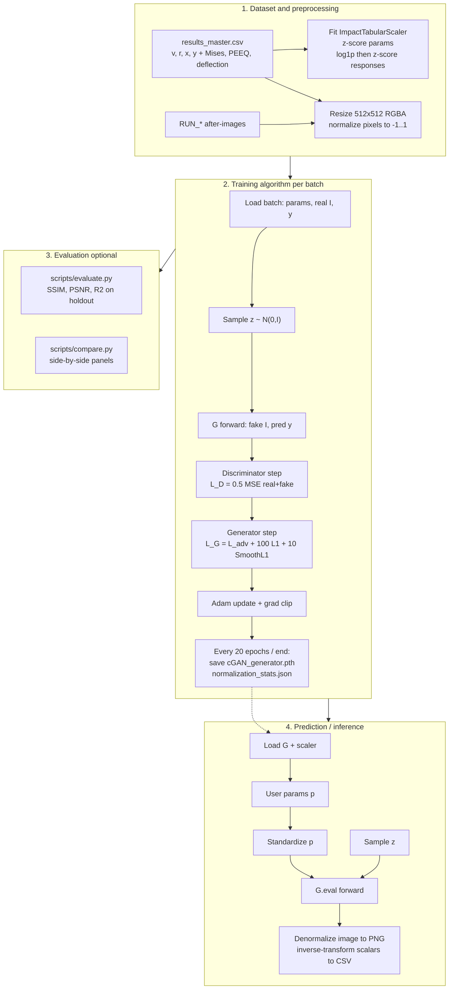

# Param2Image: Impact Simulation cGAN (PyTorch)

[](https://www.python.org/)
[](https://pytorch.org/)
[](LICENSE)

**Param2Image** is a multi-modal conditional GAN (cGAN) that acts as a fast surrogate for Abaqus impact simulations. From four impact parameters it predicts a post-impact **RGBA 512x512 image** together with three engineering scalars (peak Mises stress, peak PEEQ, and peak deflection), so you can explore design space without re-running full FEA for every case.

Trained weights are **not** shipped. Train locally or point scripts at your own checkpoint.

## Features

- Conditional generator with convolutional image head + numerical head (`physics` or `legacy`)
- Parameter-conditioned discriminator (LSGAN / MSE)
- Tabular standardization with **log1p** response scaling (`ImpactTabularScaler`)
- Train / generate / evaluate / compare / analyze CLIs under `scripts/`
- Importable package `p2i` via `pip install -e .`
- Results organized under `results/` (evaluation, comparison, analysis, predictions)

## Method overview

Full-order Abaqus impact runs are accurate but costly when many parameter combinations must be screened. Param2Image learns a conditional surrogate \(G\) that maps impact settings to a post-impact field image and three scalar FEA responses. After offline training on a finite simulation set, new queries run in milliseconds.

The sections below follow the full path: **data and preprocessing → training loop → optional evaluation → prediction/inference**. Layer-level detail lives in [docs/ALGORITHM.md](docs/ALGORITHM.md).

### Inputs and outputs

| Role | Quantity | Notes |
|------|----------|--------|
| Input | Projectile velocity \(v\) | m/s |
| Input | Projectile radius \(r\) | mm |
| Input | Impact location \((x,y)\) | mm |
| Output | After-impact image \(\hat{\mathbf{I}}\) | RGBA, \(512\times 512\), values in \([-1,1]\) |
| Output | Peak Mises \(\hat{\sigma}_{\mathrm{Mises}}\) | MPa |
| Output | Peak PEEQ \(\hat{\varepsilon}_{\mathrm{PEEQ}}\) | dimensionless |
| Output | Peak deflection \(\hat{\delta}\) | mm |

With \(\mathbf{p}=(v,r,x,y)^\top\) and latent noise \(\mathbf{z}\sim\mathcal{N}(0,I_{100})\),

\[
\big(\hat{\mathbf{I}},\,\hat{\mathbf{y}}\big)=G(\mathbf{z},\,\tilde{\mathbf{p}}),\qquad
\hat{\mathbf{y}}=(\hat{\sigma}_{\mathrm{Mises}},\,\hat{\varepsilon}_{\mathrm{PEEQ}},\,\hat{\delta}).
\]

### End-to-end workflow

The diagram below is the complete product path from Abaqus exports through training to a saved prediction. Training and inference share the same scaler statistics and generator weights.



**Training sketch (diagram Train).** For each batch the code samples \(\mathbf{z}\), runs \(G\), updates \(D\) on real vs fake images (params-conditioned), then updates \(G\) with adversarial MSE, image L1, and SmoothL1 on scaled numerics. Defaults: Adam \(\mathrm{lr}=2\times10^{-4}\), \(\beta_1=0.5\), batch size 2, 150 epochs, grad-norm clip 5. Device order: CUDA, XPU, HIP, MPS, CPU. Artifacts land in `training_checkpoints/` and `logs/`.

**Inference sketch (diagram Infer).** Load `cGAN_generator.pth` and `normalization_stats.json`, standardize the four user parameters, sample \(\mathbf{z}\), run \(G\) in eval mode, write the RGBA image under `results/predictions/`, and inverse-transform the three scalars to physical units in a CSV.

**Evaluation (optional).** After training, `scripts/evaluate.py` and `scripts/compare.py` score image metrics and numerical parity against Abaqus; they are not required for a single forward prediction.

### Generator and discriminator

The generator is multi-modal. Latent noise and scaled parameters are concatenated, \(\mathbf{h}_0=[\mathbf{z};\,\tilde{\mathbf{p}}]\in\mathbb{R}^{104}\).

- **Image head.** A linear layer forms a \(256\times 64\times 64\) feature volume, then three \(\times 2\) upsamples with convolutions yield \(512\times 512\) RGBA, followed by Tanh (\(64\to128\to256\to512\)).
- **Numerical head.** Two modes are supported:
  - `physics` (default for new training): MLP on \(\tilde{\mathbf{p}}\) only (deterministic scalars for a given impact case).
  - `legacy`: MLP on \([\mathbf{z};\,\tilde{\mathbf{p}}]\) for older checkpoints. Loaders auto-detect the mode from weight shapes.

The discriminator \(D(\mathbf{I},\tilde{\mathbf{p}})\) embeds the four parameters to a small spatial map, upsamples it to \(512\times 512\), concatenates with the image, and applies five stride-2 conv blocks to a scalar validity logit (LSGAN-style; no sigmoid inside the network).

### Objectives

With real image \(\mathbf{I}\), fake image \(G_I\), scaled targets \(\tilde{\mathbf{y}}\), and MSE adversarial loss:

\[
\mathcal{L}_D=\tfrac{1}{2}\Big(\mathrm{MSE}\big(D(\mathbf{I},\tilde{\mathbf{p}}),1\big)+\mathrm{MSE}\big(D(G_I,\tilde{\mathbf{p}}),0\big)\Big),
\]

\[
\mathcal{L}_G^{\mathrm{adv}}=\mathrm{MSE}\big(D(G_I,\tilde{\mathbf{p}}),1\big),\quad
\mathcal{L}_G^{L1}=\|G_I-\mathbf{I}\|_1,\quad
\mathcal{L}_G^{\mathrm{num}}=\mathrm{SmoothL1}_{\beta=0.5}(G_y,\tilde{\mathbf{y}}),
\]

\[
\mathcal{L}_G=\mathcal{L}_G^{\mathrm{adv}}+\lambda_{L1}\mathcal{L}_G^{L1}+\lambda_{\mathrm{num}}\mathcal{L}_G^{\mathrm{num}},
\qquad \lambda_{L1}=100,\;\lambda_{\mathrm{num}}=10.
\]

### Tabular normalization

Parameters use per-feature z-scores. Positive responses use \(\log(1+y)\) then z-scores. Images use channel-wise mean/std \(0.5\) so pixels lie in \([-1,1]\). Fitted statistics are saved as `normalization_stats.json` next to the generator weights and inverted at inference.

Layer equations, head diagrams, and design notes: [docs/ALGORITHM.md](docs/ALGORITHM.md). CLI steps: [docs/WORKFLOWS.md](docs/WORKFLOWS.md).

## Repository layout

```text
Project_19/
├── README.md
├── LICENSE
├── CONTRIBUTING.md
├── SECURITY.md
├── CODE_OF_CONDUCT.md
├── pyproject.toml
├── requirements.txt
├── .github/workflows/
├── docs/
│   ├── ALGORITHM.md          # architecture, losses, math
│   └── WORKFLOWS.md          # train → evaluate → compare → analyze
├── src/p2i/                  # importable package
│   ├── model.py
│   ├── data_loader.py
│   ├── preprocessing.py
│   └── paths.py
├── scripts/
│   ├── train.py
│   ├── generate.py
│   ├── evaluate.py
│   ├── compare.py
│   ├── analyze.py
│   └── analyze_cpu.py
├── notebooks/
│   └── train_p2i.ipynb
├── data/                     # place Abaqus_OUT here (not in git)
├── training_checkpoints/     # weights written here (not in git)
└── results/                  # evaluation | comparison | analysis | predictions
```

## Dataset

```text
data/Abaqus_OUT/
  results_master.csv
  RUN_001/
  RUN_002/
  ...
```

See [data/README.md](data/README.md). Override with `P2I_DATA_DIR` or `--data_dir` where supported.

## Installation

```bash
python -m venv .venv
# Windows: .venv\Scripts\activate
# Unix:    source .venv/bin/activate
pip install -r requirements.txt
pip install -e .
```

Install a GPU build of PyTorch from [pytorch.org](https://pytorch.org) when available.

## Quickstart

```bash
# Train
python scripts/train.py

# Generate one case
python scripts/generate.py --velocity 120 --radius 5 --impact_x 0 --impact_y 0

# Evaluate
python scripts/evaluate.py --num_samples 50

# Compare
python scripts/compare.py --num_samples 6 --selection stratified

# Analyze
python scripts/analyze.py
# or CPU-only from existing evaluation CSVs:
python scripts/analyze_cpu.py
```

Step-by-step detail: **[docs/WORKFLOWS.md](docs/WORKFLOWS.md)**.

### Output locations

| Script | Default output |
|--------|----------------|
| `train.py` | `training_checkpoints/`, `logs/` |
| `generate.py` | `results/predictions/` |
| `evaluate.py` | `results/evaluation/` |
| `compare.py` | `results/comparison/` |
| `analyze*.py` | `results/analysis/` |

## Weights policy

- Do **not** commit `*.pth` / `*.pt` or bulky result dumps.
- Train on your machine, or load via `--model_path`.
- See [training_checkpoints/README.md](training_checkpoints/README.md).

## Citation

If you use this surrogate in academic work, please cite the repository and describe the Param2Image / Train_v2 cGAN pipeline (parameters → image + numerical FEA responses).

## License

MIT. See [LICENSE](LICENSE).

## Contributing

See [CONTRIBUTING.md](CONTRIBUTING.md) and [CODE_OF_CONDUCT.md](CODE_OF_CONDUCT.md). Security notes: [SECURITY.md](SECURITY.md).
