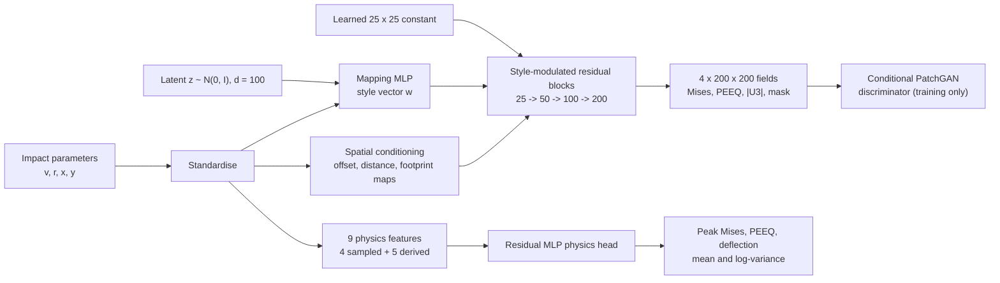

<div align="center">

# Param2Image

**A conditional StyleGAN-lite surrogate for ABAQUS/Explicit projectile-impact simulations**

[](https://github.com/mlbkumar9/Param2Image/actions/workflows/ci.yml)
[](https://www.python.org/)
[](https://pytorch.org/)
[](LICENSE)
[](pyproject.toml)

</div>

Param2Image maps four impact parameters (projectile velocity, projectile radius and strike position x, y) directly to the full-field damage response of a clamped aluminium plate. It predicts four physical fields on the plate's own finite-element grid, together with the three peak responses and their uncertainty. A single prediction takes about 0.6 s on four CPU cores, against a mean of 82.6 s for the ABAQUS solve it replaces.

This repository contains the model reported in the manuscript *Generative Deep Learning for Impact Simulations: A Conditional StyleGAN-Lite Framework for Parameter-to-Image Synthesis* (Behera, Sahu, Sutrakar, Budarapu), submitted to *Machine Learning with Applications*.

## Contents

- [Highlights](#highlights)
- [Results](#results)
- [Method](#method)
- [Installation](#installation)
- [Quick start](#quick-start)
- [Training configuration](#training-configuration)
- [Data](#data)
- [Repository structure](#repository-structure)
- [Testing](#testing)
- [Citation](#citation)
- [Contributing](#contributing)
- [Author](#author)
- [License](#license)
- [Acknowledgements](#acknowledgements)

## Highlights

- **Physical outputs, not pictures.** The network predicts von Mises stress, equivalent plastic strain, out-of-plane displacement and a perforation mask on the 200 x 200 element grid (3.000 mm per cell). Every pixel is one element and converts back to MPa, strain or millimetres.
- **Two branches.** A style-modulated generator produces the fields; an independent physics head predicts peak stress, plastic strain and deflection with a predictive variance.
- **Measured against the solver itself.** Mean SSIM of 0.962 on 604 held-out cases, against 0.963 between two simulations of the same impact and 0.908 for a nearest-neighbour baseline built from real simulations.
- **Reproducible.** Every resolved hyperparameter is stored in the checkpoint, the test split is never read during training, and the command-line defaults reproduce the reported run.

## Results

Held-out test split, 604 cases, generator output averaged over 8 latent draws, scored against the unfiltered finite-element fields.

**Field accuracy (SSIM)**

| | all channels | von Mises | PEEQ | deflection | mask |
|---|---|---|---|---|---|
| Param2Image | **0.962** | **0.897** | **0.985** | **0.981** | **0.984** |
| Nearest-neighbour baseline (real simulations) | 0.908 | 0.765 | 0.960 | 0.941 | 0.967 |
| Two simulations of the same impact | 0.963 | 0.897 | | | |

**Peak responses (physics head)**

| response | MAPE | R² | MAE |
|---|---|---|---|
| Peak von Mises stress | 2.30 % | 0.809 | 19.5 MPa |
| Peak plastic strain (PEEQ) | 11.25 % | 0.811 | 0.066 |
| Peak deflection | 9.45 % | 0.899 | 0.97 mm |

**Impact location.** Median position error 0.99 mm (one third of an element); 79 % of cases are located to better than 3 mm. The same locator applied to the real fields has a floor of 1.1 mm.

**Cost.** Training: 4.85 h on one NVIDIA A100 (545 epochs, early stop). Inference: 0.6 s per case for one forward pass on four CPU cores, or about 5 s for the 8-draw estimate used above. Model size: 21.3 M parameters (generator 10.35 M, discriminator 9.36 M, physics head 1.59 M).

## Method



**Generator.** A mapping MLP turns the standardised parameters and a 100-dimensional latent vector into a style vector *w*. A learned 25 x 25 constant is upsampled to 200 x 200 through residual blocks whose instance-normalised activations are modulated channel-wise by *w* (AdaIN). With spatial conditioning, maps of the offset from the strike point, the distance to it and the projectile footprint are projected and added to the features at every resolution, so the network does not have to infer position from a vector alone. Outputs are mapped to [-1, 1] per channel (linear for stress and mask, square root for strain and deflection) and inverted exactly at inference.

**Physics head.** An independent residual MLP that maps the parameters to the mean and log-variance of the three peak responses. Its inputs are the four sampled parameters plus five derived quantities (the log and cube root of r³v², which is proportional to kinetic energy; the radial distance from the plate centre; the distance to the clamped edge; and v·r²). The mean is fitted with a Huber loss and the variance by a Gaussian negative log-likelihood on the detached residual, so learning the uncertainty does not pull the mean. The head trains for 100 epochs, is then frozen, and is checkpointed on its own validation loss.

**Discriminator.** A spectral-normalised PatchGAN conditioned on the parameters, with a minibatch standard-deviation layer, trained on differentiably augmented inputs (colour jitter and cutout).

**Objective.** The generator minimises

```
L_G = L_adv + λ_L1 · Σ_c w_c ‖G_c − I_c‖₁ + λ_pos · L_pos + λ_peak · L_peak
```

where `L_adv` is the non-saturating logistic loss, `w_c` are per-channel weights (1.93, 0.63, 0.90, 0.53), `L_pos` compares the impact location read from the generated fields with the recorded strike coordinates, and `L_peak` matches a soft maximum of each generated stress, strain and deflection channel to that of the real field (deflection over intact material only). The discriminator uses the logistic loss with a lazy R1 penalty (γ = 10, every 16 steps). The training target is box-filtered over 3 x 3 cells on intact material; the reported scores are computed against the unfiltered fields. Generator and physics-head weights are averaged with an EMA of decay 0.999.

## Installation

Requires Python 3.10 or newer. Install a PyTorch build that matches your hardware first (see [pytorch.org](https://pytorch.org/get-started/locally/)), then:

```bash
git clone https://github.com/mlbkumar9/Param2Image.git
cd Param2Image
pip install -e .            # core
pip install -e ".[fid]"     # adds torchvision for FID/KID in p2i-evaluate
pip install -e ".[dev]"     # adds pytest
```

## Quick start

**Train** with the configuration reported in the paper (all defaults):

```bash
p2i-train --csv DATA/results_master.csv --pack DATA/fields_pack.npy \
          --out runs/v36 --cache-ram --num-workers 8
```

**Evaluate** on the held-out test split:

```bash
p2i-evaluate --csv DATA/results_master.csv --pack DATA/fields_pack.npy \
             --ckpt runs/v36/ckpt_best.pt --ckpt-phys runs/v36/ckpt_best_phys.pt \
             --split test --out results/eval_test
```

**Predict** a single impact case:

```bash
p2i-predict --ckpt runs/v36/ckpt_best.pt --ckpt-phys runs/v36/ckpt_best_phys.pt \
            --velocity-kmh 300 --radius-mm 50 --x-mm 0 --y-mm 0 \
            --out pred.npz --png
```

`pred.npz` holds the four fields in physical units and the predicted peak responses; `--png` also writes one image per channel.

**Pack** per-run field maps into the training array:

```bash
p2i-pack --csv DATA/results_master.csv --out DATA/fields_pack.npy
```

Each command is also available as `python -m p2i.<train|evaluate|predict|pack_dataset>`; run any of them with `--help` for the full option list.

## Training configuration

| setting | value | setting | value |
|---|---|---|---|
| Split (train / val / test) | 4832 / 604 / 604 | Latent dimension | 100 |
| Batch size | 32 | Epoch budget | 600 (early stop, patience 120, min. 150) |
| LR, G / D / physics | 1e-4 / 4e-5 / 5e-4 | LR schedule | cosine, 5-epoch warmup, floor 1e-6 |
| Optimiser, G / D | AdamW (0.0, 0.99) | Optimiser, physics | AdamW (0.9, 0.999) |
| Weight decay, G / D; physics | 1e-4; 1e-3 | EMA decay | 0.999 |
| λ_L1 | 10 | λ_pos | 10 |
| λ_peak (temperature) | 15 (20) | R1 γ, interval | 10, 16 steps |
| Target filter | 3 x 3 cells, intact only | Precision | bfloat16 mixed |

Checkpoints are selected on validation SSIM; the test split is used only by `p2i-evaluate`.

## Data

The simulations model a 600 x 600 x 5 mm Al 2024-T351 plate, clamped on all edges and struck normally by a rigid steel sphere, with Johnson-Cook plasticity and damage and element deletion. The plate mesh is a uniform 200 x 200 x 6 grid of 240,000 C3D8R elements.

| quantity | range |
|---|---|
| Impact velocity | 10 to 800 km/h |
| Projectile radius | 25 to 100 mm |
| Strike position x, y | about ±272 mm from the plate centre |
| Peak von Mises stress | 568 to 1145 MPa |
| Peak plastic strain | 0.063 to 1.88 |
| Peak deflection | 0.77 to 45.7 mm |

The 6040-simulation dataset is part of an ongoing study and is not distributed with this repository. [data/README.md](data/README.md) specifies the layout the code expects, so the pipeline can be run on your own simulations, and `data/verify_dataset.py` checks a dataset folder against it. The scripts in [`abaqus/`](abaqus/) generate such a dataset: `run_campaign.py` builds and solves the cases, and `extract_fields.py` reads each output database into a per-run field map.

## Repository structure

```text
Param2Image/
├── src/p2i/
│   ├── model.py          generator, physics head, discriminator, DiffAug, EMA
│   ├── data.py           dataset, channel mapping, scalers, physics features
│   ├── metrics.py        SSIM, impact locator, peak and consistency metrics
│   ├── train.py          p2i-train
│   ├── evaluate.py       p2i-evaluate (SSIM, scalar errors, retrieval baseline, FID/KID)
│   ├── predict.py        p2i-predict
│   └── pack_dataset.py   p2i-pack
├── abaqus/               simulation campaign and field extraction (ABAQUS Python)
├── data/                 dataset format and verifier (no data files)
├── tests/                CPU smoke tests
└── .github/              CI and issue templates
```

## Testing

```bash
pip install -e ".[dev]"
pytest -q
```

The smoke tests build a small synthetic dataset, train for two epochs on CPU, then run evaluation and prediction. They run in under a minute and are executed by CI on every push.

## Citation

If you use this code, please cite the repository (see [CITATION.cff](CITATION.cff)):

```bibtex
@software{param2image,
  author  = {Behera, Mahendralal},
  title   = {Param2Image: A Conditional StyleGAN-Lite Surrogate for Projectile-Impact Simulations},
  version = {3.6.0},
  year    = {2026},
  url     = {https://github.com/mlbkumar9/Param2Image}
}
```

A citation for the journal article will be added once it is published.

## Contributing

Bug reports and pull requests are welcome. Please read [CONTRIBUTING.md](CONTRIBUTING.md) first and follow the [Code of Conduct](CODE_OF_CONDUCT.md). Security issues should be reported privately as described in [SECURITY.md](SECURITY.md).

## Author

Developed and maintained by Mahendralal Behera ([@mlbkumar9](https://github.com/mlbkumar9)).

## License

Released under the [MIT License](LICENSE).

## Acknowledgements

This work was carried out at the School of Mechanical Sciences, Indian Institute of Technology Bhubaneswar, and was supported by the Aeronautical Development Establishment, Defence Research and Development Organisation, Bengaluru, India (grant ADE/PPA/14923/CARS/25-26/06).
